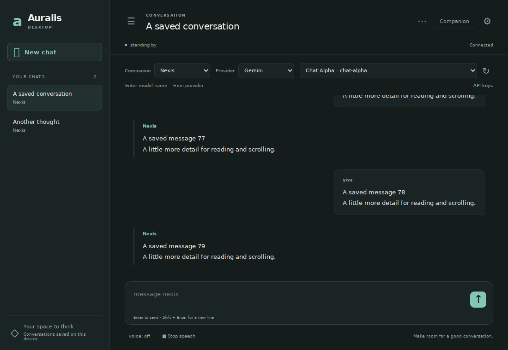
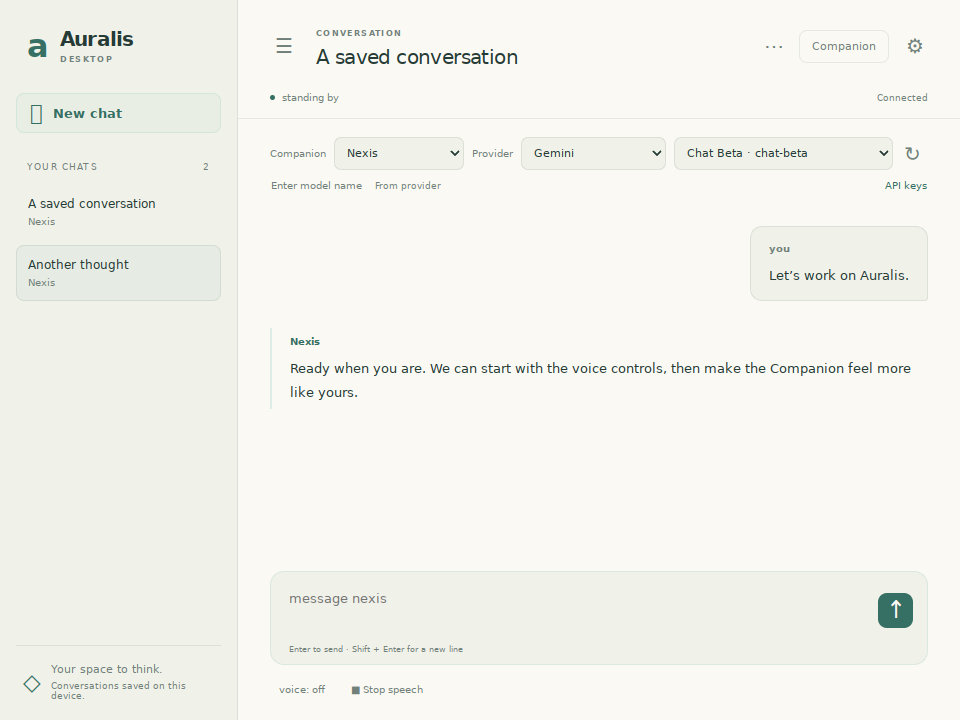

# Auralis Desktop

Desktop is a normal native window with its own application runtime. It does not wait for a terminal. Native title-bar buttons handle minimize, maximize and close; native borders handle resizing. There is no pin, always-on-top mode, custom drag region, or custom resize corner.

## Launch on Windows

```powershell
python -m pip install -r requirements.txt
.\run-desktop.bat
```

`run.bat` also opens Desktop. It uses `pythonw.exe` so no terminal remains open alongside the app. A project `.venv` or `venv` is used when present. Windows WebView2 is required by the native renderer; startup problems show an error dialog and are recorded in `data/desktop.log`.

For Terminal instead:

```powershell
.\run-terminal.bat
```

Use `.\run-terminal.bat --plain` for the basic prompt. Direct `python start.py` remains supported. There is no remembered interface chooser yet. To diagnose Desktop from a visible console, use `python desktop.pyw`.

Desktop and Terminal read the same chats, memory, characters, settings and `.env`. Only one application instance can own a project's data directory at a time; close one interface before launching the other. This prevents simultaneous writers. No migration or deletion of existing chats is performed.

## Chat controls

- The sidebar button shows/hides saved chats. New chat starts from your defaults; selecting a saved chat restores its provider/model/character and its in-memory draft.
- The chat actions menu offers Rename, Clear messages, and Delete. Clear/Delete require an explicit confirmation with Cancel initially focused. The chat limit remains enforced; delete a chat to make room.
- Choose a character, provider and discovered model in the toolbar. Failed/stale actions leave the current selection and drafts intact. Session-changing actions wait until a reply finishes.
- Enter sends; Shift+Enter adds a line. Stop cancels current/pending speech; it does not abort a provider's HTTP request.
- Voice enables/disables saved voice output. Fish Audio requires its own API key. The Companion button reveals the existing avatar; Appearance controls its existing presets, color, theme and motion.
- Closing the native window stops voice and the local server. A late provider reply is discarded after shutdown. Minimize keeps the app running. Window geometry is saved in `data/desktop_window.json`.

## Providers and keys

Open **API keys**, select a provider, paste its key into the masked field, and Save. Keys are written to the project's ignored local `.env` file, not encrypted vault storage. They are never returned by the API or put in conversation history. Do not share your `.env` file. Existing entries and comments are preserved. A failed save does not change the active process key.

| Provider | Environment variable |
|---|---|
| Gemini | `GEMINI_API_KEY` |
| OpenAI | `OPENAI_API_KEY` |
| Claude | `ANTHROPIC_API_KEY` |
| OpenRouter | `OPENROUTER_API_KEY` |
| DeepSeek | `DEEPSEEK_API_KEY` |
| Grok | `XAI_API_KEY` |
| Fish Audio voice | `FISH_AUDIO_API_KEY` |
| Ollama | No key; requires a running local Ollama service |

Saving a key refreshes provider/model discovery without a restart. Choose the desired provider and model explicitly. Listing a model does not guarantee quota, access, or compatibility; a cached/manual fallback remains available if discovery fails. No paid chat request is sent just to save a key.

## Previews

Synthetic backend data; these show the page content inside the native window, without operating-system title-bar decorations.




## Verification

The complete Python suite passes **613 tests**; all three JS harnesses and the headless Chromium Desktop smoke pass. The suite covers shared runtime ownership/lifecycle, late replies on shutdown, authenticated management routes, busy/stale state, destructive confirmations, failed actions, credential redaction/atomic writes, simulated native window behavior, frontend controls and existing terminal regressions. See the PR for final test counts and CI results.

The native host is tested through fakes on CI; real Windows title-bar, DPI, WebView2 and audio behavior still need a laptop smoke test. The earlier save/index transaction and corrupt-index recovery findings remain follow-ups; see `docs/reviews/2026-10-27-auralis.md`.

STT, vision, tools, avatar redesign, remembered launch selection, and 3D VTuber models are not included.
