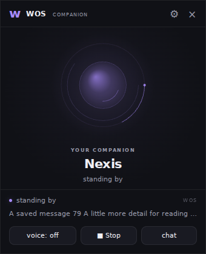
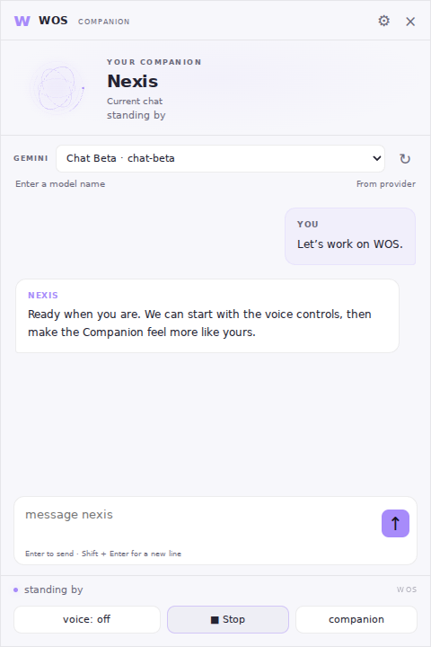

# WOS Companion

The Companion and chat views use the same session, character, models, memories,
chat files, and voice player as the terminal.

## Run

```text
pip install -r requirements.txt
run.bat
```

`run.bat --browser` opens the browser version. Without pywebview, WOS falls back
to your browser automatically. `python start.py` still runs the terminal alone.

## Companion and chat

- Drag the dedicated header to move the desktop window. Message text remains selectable.
- Resize with the bottom-right grip or the native window edges. Each view remembers
  its own dimensions and position, and restored windows stay on an attached screen.
- **Chat / companion** switches views. Chat supports multiline input, copy buttons,
  earlier-message loading, and preserving your reading position when new replies arrive.
- Enter sends; Shift+Enter adds a line. Drafts survive a temporary disconnect and
  are kept separately for each chat while the window stays open.
- The pin toggles always-on-top on desktop. Minimize leaves WOS running.
- Appearance offers Orb, Orbit rings, and Waveform, with separate light/dark theme,
  accent, avatar size, glow, and motion controls. Settings save automatically.
  System reduced-motion settings disable decorative motion.

## Voice and stopping

Set `FISH_AUDIO_API_KEY` in `.env` or your environment; never put keys in a chat.
The **voice** switch controls future replies and is remembered in `settings.json`.
Turning it off also stops the current/pending speech. It does not require a
restart. Missing keys and voice failures have explicit status messages.

**Stop**, Escape in the chat input, or terminal `/stop` cancels current and
pending speech without muting future replies. At the terminal's main prompt,
Ctrl+C stops active speech; with no speech active, Ctrl+C exits as before.
Closing the desktop window (including Alt+F4), exiting the terminal, or restarting
also stops speech. A reply that was still being generated when stopped will stay
text-only. A new message interrupts the previous spoken reply.

The status distinguishes **analysing**, **preparing voice**, and **speaking**.
Speech is synthesized as a complete WAV before playback begins; this change does
not introduce streaming TTS or delay text until audio is ready.

## Models

After configuring a new Gemini key, the terminal offers a numbered model picker
for the current chat. `/model` and `/provider` also discover models from Gemini,
filtering for `generateContent` support. The chat view has a model dropdown and
Refresh control. Manual names remain an optional fallback.

Discovery fetches all pages, sends the key in a request header, and caches results
for ten minutes. If discovery fails, WOS identifies the cached/saved list and shows
a clear warning. Cache records contain a key fingerprint, never the key itself.
A listed model does not guarantee quota, billing eligibility, or generation access.
Ollama continues to list the models installed on your computer.

Model changes affect the current chat. `/defaults model` sets the model for new
chats. Cancelling a picker preserves the current selection.

## Reliability and storage

- Terminal chat/character/model changes refresh the Companion immediately.
- Polls have timeouts; disconnected controls are disabled and the draft is preserved.
- Controlled `/restart` retains the port and token so browser clients reconnect.
  Desktop clients can also read a changed endpoint after a fresh launch.
- Message identifiers prevent duplicate delivery when retrying a lost response in
  the same backend process. These identifiers are not persisted across a full restart.
- Appearance: `data/companion.json`; window geometry: `data/companion_window.json`;
  model discovery: `data/model_catalog.json`; initial key setup: `data/cloud_model_setup.json`.
  Chats and credentials are never sent to the UI as configuration files.

The local server is bound to 127.0.0.1. API routes require the private token and
reject foreign hosts/origins. Browser clients cannot discover a fresh token from
the filesystem; after completely closing and relaunching the terminal, reopen
`run.bat --browser` to obtain the new URL.

## Validation

```text
python -m pip install requests python-dotenv
python -m unittest discover -s tests -t .
node --check overlay/web/chat.js
node --check overlay/web/sage.js
```

Tests use fake provider responses/audio and temporary data, without real API keys
or paid requests. GitHub Actions runs the Python and JS checks on Linux and Windows.
Optional rendered UI checks:

```text
npm install --no-save playwright@1.62.1
npx playwright install chromium
node tests/browser_smoke.cjs
```

The browser smoke checks use synthetic messages and model metadata. They cover
model selection, safe retries, literal rendering, scroll/draft preservation,
reconnection, appearance, and small-window layouts. They do not exercise native
Windows dragging, sound hardware, or pywebview's GUI loop. Those require a real
Windows desktop smoke test. Audio animation follows the WAV envelope and estimated
playback duration with 150 ms state polling; it is not sample-accurate.

## Preview

Browser previews with synthetic messages and model names:



