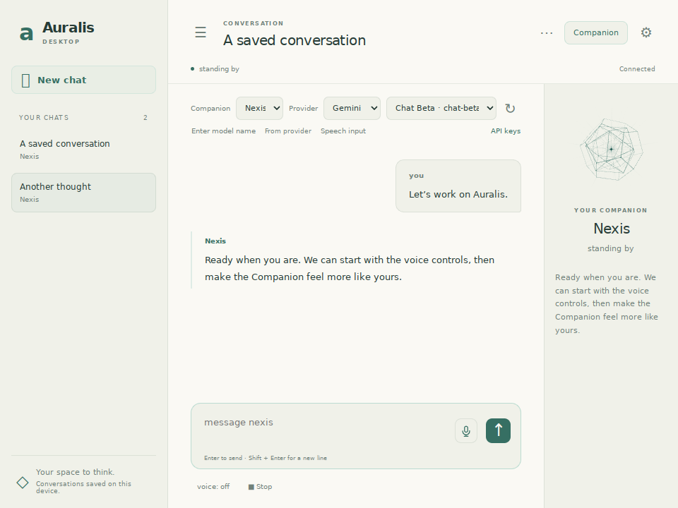
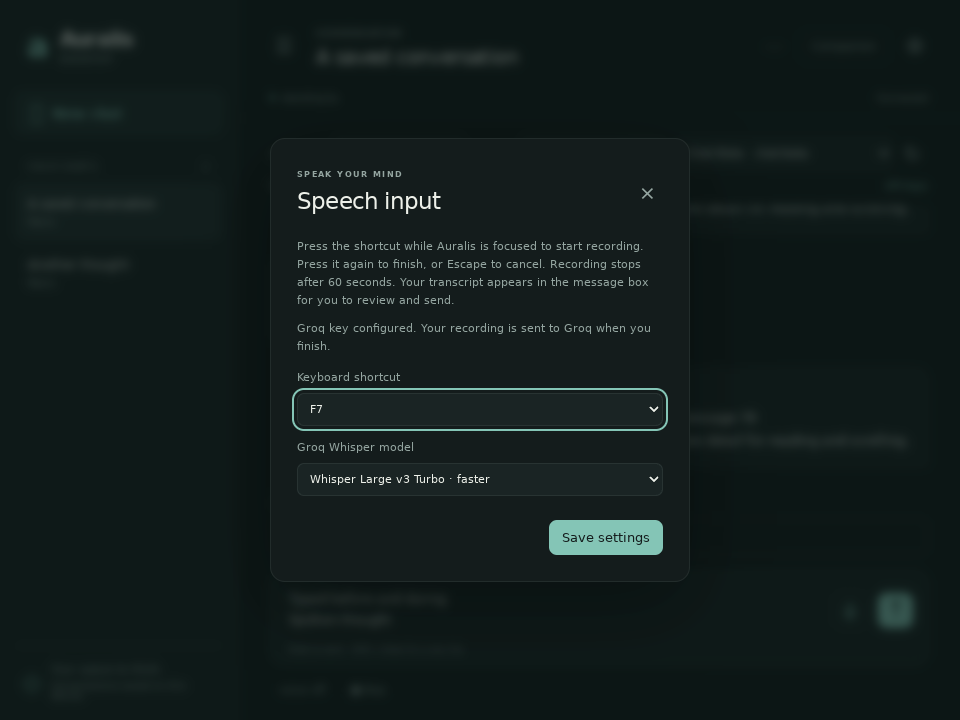

# Speech input and the Astral lattice

## Set up dictation

Install the updated requirements in the same Python environment that runs Auralis:

```powershell
python -m pip install -r requirements.txt
```

In Desktop, open **API keys**, choose **Groq · speech to text**, paste your Groq API key, and save. Terminal users can set `GROQ_API_KEY` in the project's local `.env` file and restart. This key is separate from your chat provider and Fish Audio voice-output key; using speech input does not change your chat model.

Groq handles transcription in the cloud. Audio is sent to its speech endpoint only when you finish a valid recording. Auralis keeps the recording in memory and does not write an audio file. See Groq's [speech documentation](https://console.groq.com/docs/speech-to-text) and [account limits](https://console.groq.com/docs/rate-limits) for service availability, quotas and pricing. Auralis does not assume an unlimited free allowance.

## Record, review, send

1. Focus Auralis and press **F7**, or click the microphone beside Desktop's message box. Current spoken output stops before recording begins.
2. Speak into the computer's default input device. The status shows recording time; Desktop also shows the input level.
3. Press **F7** again, or click the microphone, to finish. Recording ends automatically after 60 seconds. The status changes to Transcribing.
4. The transcript is appended to the current draft on a new line. Review or edit it, then send when ready. Auralis never sends a transcript automatically.

Keep typing while recording or transcribing. Existing draft text stays intact. Chat/model/character changes and sending wait until input finishes or is cancelled, keeping the transcript attached to its original chat. An old or cancelled result is discarded.

**Escape**, Desktop's **Cancel** or **Stop**, Terminal's **Ctrl+C**, and closing Auralis cancel input. Cancellation suppresses late results. A cloud request already submitted can still finish at the service; closing does not wait for it.

## Settings and shortcuts

Desktop's **Speech input** link and Terminal's **`/stt`** picker configure the model and focused shortcut. Choose **F7**, **F9** or **F10**. These shortcuts work while the interface is focused; they are not global hotkeys. On laptops you may need Fn plus the function key.

The default model is `whisper-large-v3-turbo`; `whisper-large-v3` is also available. Settings are shared across interfaces in `settings.json`:

```json
"stt": {
  "provider": "groq",
  "model": "whisper-large-v3-turbo",
  "shortcut": "f7"
}
```

The basic `--plain` prompt has no function-key capture or editable composer. Use `/stt start`, `/stt stop`, `/stt cancel`, and `/stt result`; the last command prints and clears a completed transcript without sending it.

## If recording fails

- **Missing key:** save a Groq key under API keys, or check `GROQ_API_KEY` and restart.
- **Missing microphone package:** run the installation command above with the Python environment used by Auralis. Microphone support loads only when recording starts.
- **Microphone unavailable:** check your default recording device, Windows microphone access for desktop applications, and whether another application has exclusive access.
- **Too short or silent:** record for at least 0.3 seconds and check that the input-level meter responds. The silence check measures audio energy, not speech recognition.
- **Network, key or quota error:** your draft remains available. Retry when the underlying problem is resolved; Auralis does not retry an upload automatically.

There is no background listening, offline transcription, input-device picker or push-to-talk hold mode in this version.

Use one speech-input interface per running backend. Opening extra local chat pages through the development `--overlay` helper does not give each page an independent transcript queue.

## The new 2D Companion

Open **Companion** in Desktop to reveal **Astral lattice**: three hollow, projected geometric shells around a luminous star core, with depth shading and radial light. It is a Canvas2D animation, separate from the deferred 3D VTuber model.

The shells, core and rays react to actual spoken-output audio levels rather than a fixed talking loop. Recording uses live microphone levels. Quiet audio settles smoothly, and transitions between idle, thinking, speaking, listening and transcribing are blended. The terminal remains text-only.

**Appearance** controls color, size, glow, motion and light/dark theme. Existing crystal, orb, rings and waveform preferences migrate to Astral lattice while preserving their other appearance values. System reduced-motion settings and Motion = 0 freeze geometric movement and expansion; Glow = 0 removes the halo, rays and motes.

These previews use synthetic chat and service data; they do not show a live microphone or cloud request.




## Validation limits

Automated tests use fake microphone streams, synthetic WAVs, fake provider responses and a real headless Chromium UI. They do not record your microphone or contact Groq. Physical microphone permissions, the native Windows host, and real cloud transcription still require a device smoke test.
