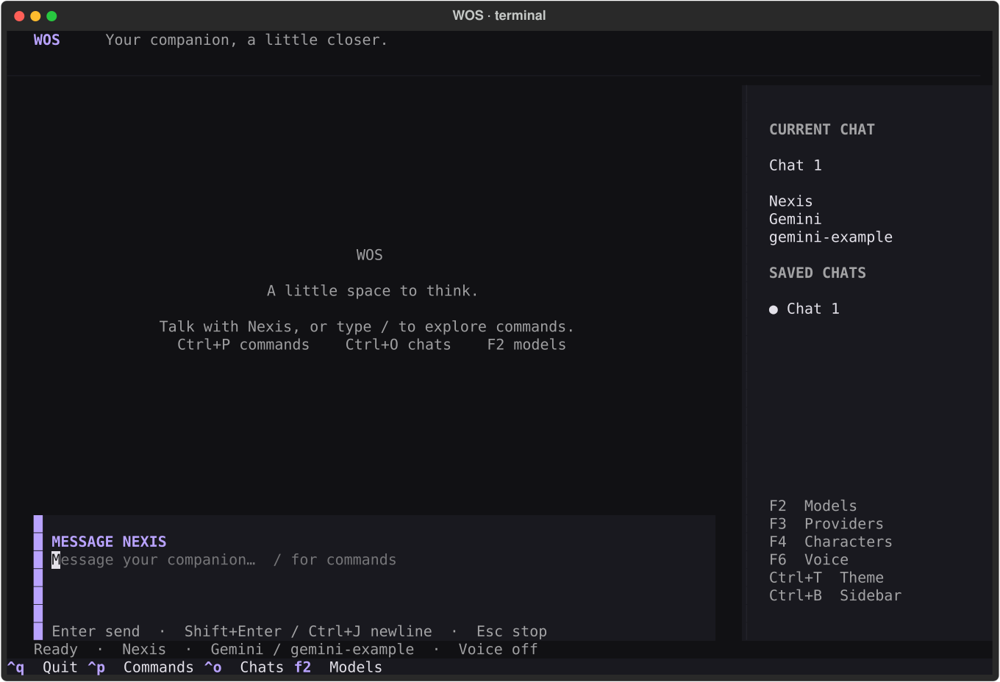
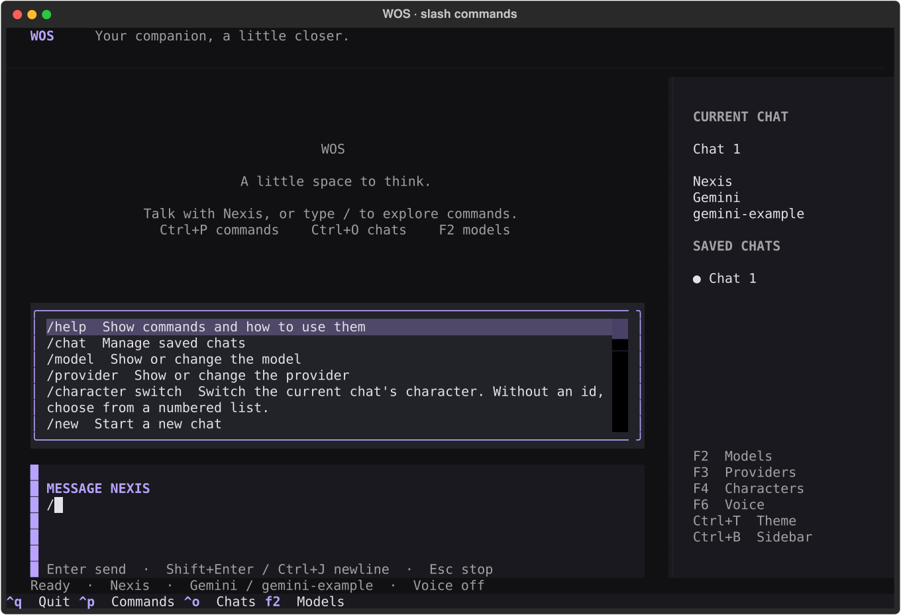
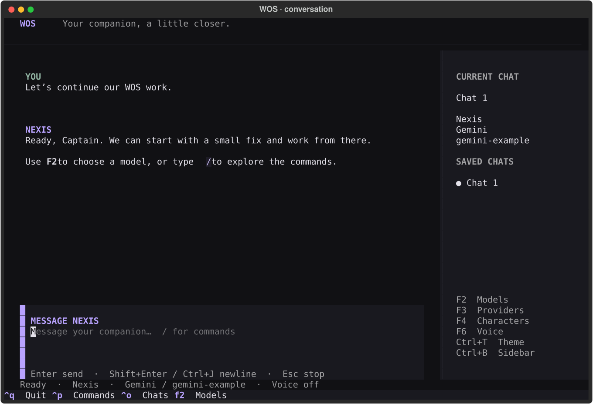
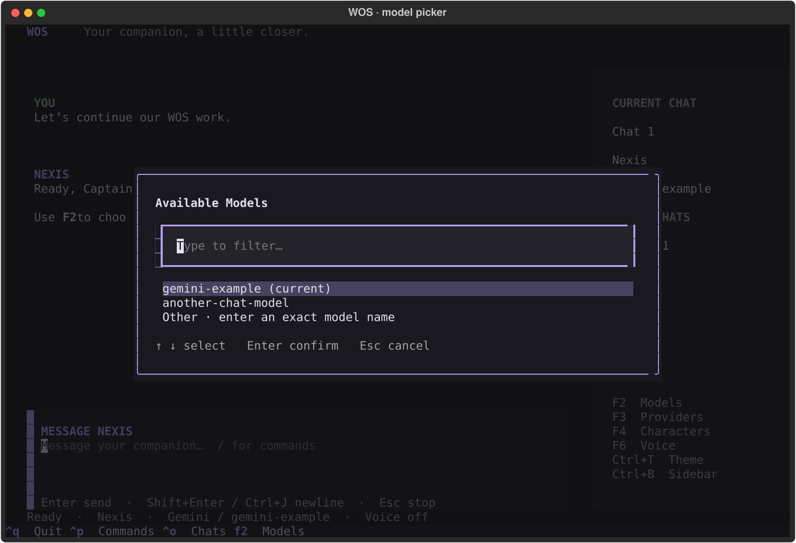

# WOS terminal

WOS now opens a full-screen terminal interface with a fixed composer, Markdown
conversation, searchable menus, slash-command completion, status bar, and saved
chat sidebar. The layout takes inspiration from OpenCode; it uses WOS's existing
Python session and commands. The Companion remains another view of that session.

## Run

```powershell
python -m pip install -r requirements.txt
.\run.bat
```

`python start.py` opens the TUI in an interactive terminal. Add `--overlay` to
serve the Companion too. `run.bat` launches both as before and forwards options.
`--tui` explicitly requests the full-screen interface; `--plain` keeps the basic
line prompt. Redirected/piped input uses the basic prompt automatically.

If Textual is missing, WOS explains how to install it and falls back to the basic
prompt. Existing chats, memory, characters, provider keys, and voice settings are
reused. The terminal does not create a second conversation or voice player.

## Commands and shortcuts

Type `/` at the beginning of the composer to open command suggestions. Keep
typing to filter; use Up/Down to select, **Tab** to complete, or **Enter** to run.
Subcommands such as `/chat switch` and `/memory edit` are included. Commands needing
arguments can be completed with Tab, then followed by their arguments. Existing
commands still work when typed in full. Escape hides suggestions while keeping
what you typed.

| Key | Action |
|---|---|
| Enter or Ctrl+Enter | Send a message or run the selected command |
| Shift+Enter or Ctrl+J | Insert a newline; Ctrl+J is the fallback when the terminal cannot distinguish Shift+Enter |
| Ctrl+P | Searchable command palette |
| Ctrl+N | New chat, using the existing chat-limit flow |
| Ctrl+O | Search and switch saved chats |
| F2 | Choose a model |
| F3 | Choose a provider, then its model |
| F4 | Choose a character |
| F6 | Toggle saved voice output |
| Escape | Dismiss suggestions, cancel a picker/prompt, or stop speech |
| Ctrl+C | Cancel a picker/prompt and stop current/pending speech |
| Ctrl+Q or `/exit` | Close WOS and stop speech |
| PageUp / PageDown | Scroll the conversation |
| Ctrl+B | Show/hide the chat sidebar; hidden automatically in narrow windows |
| Ctrl+T | Switch light/dark terminal theme |
| Ctrl+L | Hide command output; does not erase the conversation |

Menus support filtering, mouse selection, Enter, and Escape. Destructive actions
such as clearing a conversation still require confirmation, with Cancel focused
by default. Command output appears in a bounded scrollable panel.

You can type the next draft while a reply loads. Sending and session-changing
commands wait for the current action to finish, avoiding accidental double sends
or applying a model to the wrong chat. A failed reply restores the submitted text
when the composer is empty. If you already typed a next draft, that draft stays
in place and the unsent message is shown in command output. No automatic retry
is performed. Drafts are kept separately per chat while
the terminal is open. Reading position survives background conversation updates;
scroll to the top and use **Load earlier messages** for older history.

## Implementation review

The review covered the new UI, existing command paths, shared-session behavior,
thread ownership, shutdown/restart, and failure handling.

| Finding | Change |
|---|---|
| Editor arrow-key bindings could consume suggestion navigation | Context-aware bindings route arrows to the popup while it is visible |
| Early quit handling could interfere with framework shutdown | Separated application shutdown state; verified Ctrl+Q and terminal restoration |
| Terminal resizing could retain a sidebar sized for the previous width | Uses the resize event's dimensions; tested from 48×18 to 160×48 |
| Pending replies or prompts could block exit, or leave a command lock held | One command worker owns/releases the lock; closing resolves prompts and stops speech |
| Full transcript remounts caused unnecessary layout work | Batch mounts, revision checks, and retained reading position |
| Character changes and failed renders could leave stale history labels | Character-aware history signatures and retryable revisions |
| Failed replies could discard submitted text or overwrite the next draft | Restores an empty composer and retains unsent text in command output when a next draft exists |
| Clearing a chat before a failed save left the in-memory messages empty | Restores messages on a failed clear save; regression checks memory, context, and disk |

### Remaining improvements and limits

- Escape/Ctrl+C cancels speech and suppresses late speech for the current reply.
  It does **not** cancel an in-flight model request. The UI stays responsive, and
  Ctrl+Q can exit while that request is running. A provider may still finish or
  charge for an already submitted request. True generation cancellation/streaming
  would need provider-specific work.
- Voice still synthesizes a complete WAV before playback; this UI change does
  not remove that preparation delay.
- Theme, sidebar visibility, and unsent drafts currently last for the running
  terminal session. Persisting those preferences and adding sent-input history
  are useful follow-ups.
- Terminal key encodings and clipboard behavior vary. Use Ctrl+J for a newline
  if Shift+Enter is indistinguishable from Enter. Native Windows terminal and
  real audio playback still benefit from a desktop smoke test.

No STT, vision, or VTuber-model work is included.

## Validation

```powershell
python -m unittest discover -s tests -t .
node tests/js/chat_harness.js
node tests/js/avatar_harness.js
```

The combined suite passes **569 tests**, including 21 new terminal regressions.
The new headless Textual tests exercise actual key events and the existing WOS
command loop with temporary chats and fake provider responses. They cover
completion, filtering, provider/model selection, destructive confirmations, draft
switching, multiline messages, responsive layouts, earlier history, background
updates, voice settings, unexpected command errors, and exit/restart during work.
No real API key, paid request, or audio hardware is used by these tests. A local
Linux PTY smoke check also exercised automatic TUI startup, slash suggestions,
Ctrl+Q, and restoration of the terminal's alternate screen.

## Previews

Rendered Textual previews with synthetic messages and model IDs. They represent
the terminal content; the surrounding terminal window depends on your terminal.






The SVG originals are in `docs/`. Regenerate them with
`python -m tests.terminal_preview` (no provider requests).
